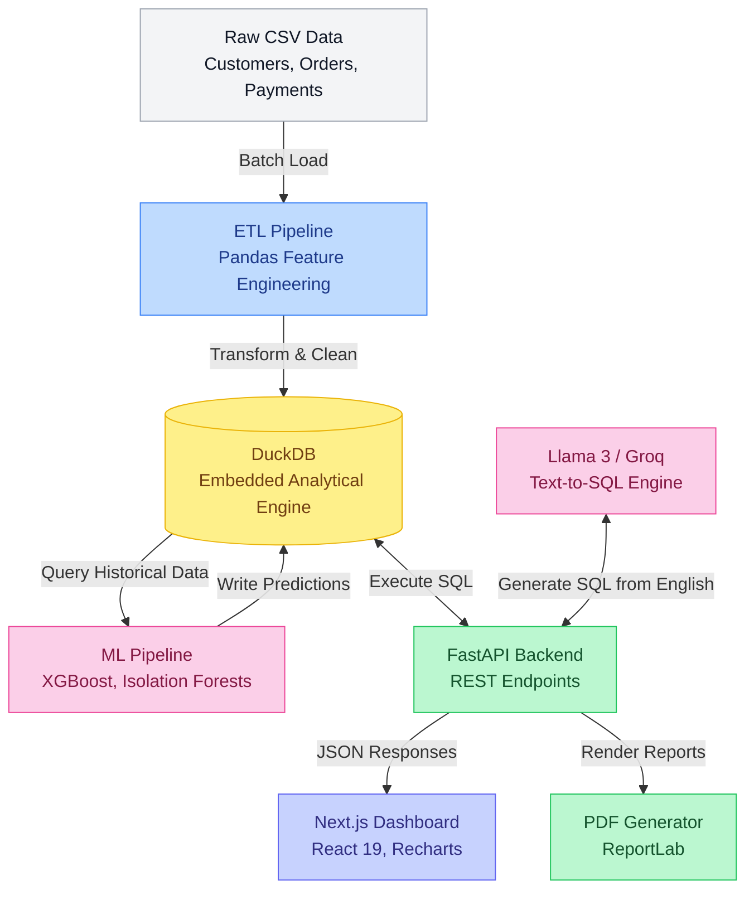

# IntelliVest - AI-Powered Business Intelligence & E-Commerce Analytics

A full-stack **Predictive Business Intelligence Platform** built with **FastAPI**, **DuckDB**, **Next.js**, and **XGBoost**. Designed to analyze large-scale e-commerce datasets with machine learning models for revenue forecasting, customer segmentation (RFM), anomaly detection, and LLM-powered (Groq/Llama3) natural language SQL querying.

---

## ⚡ Quick Start

### 1. Prerequisites
- Python 3.10+
- Node.js 18+

### 2. Setup & Start Backend
```bash
# Install Python dependencies
pip install -r requirements.txt

# Start FastAPI server
uvicorn backend.api.main:app --reload --port 8000
```
API runs at: **`http://localhost:8000`** (Swagger docs at `http://localhost:8000/docs`)

### 3. Setup & Start Frontend
```bash
# Move to frontend directory
cd frontend

# Install Node dependencies
npm install

# Start Next.js development server
npm run dev
```
Dashboard runs at: **`http://localhost:3000`**

---

## 🐳 Docker Setup

Run backend and frontend together using Docker Compose:

```bash
docker-compose up --build
```

- **Web Dashboard**: `http://localhost:3000`
- **FastAPI Documentation**: `http://localhost:8000/docs`

---

## 🔄 Data Pipeline & System Architecture

This project follows a modern, embedded data architecture designed for speed and predictive analytics without requiring a heavy cloud warehouse.



### 🧠 How It Works (For Interviews):
1. **Data Ingestion & ETL**: Raw e-commerce CSVs are processed using Pandas. The ETL pipeline performs extensive feature engineering (e.g., calculating Recency, Frequency, Monetary values) and loads the cleaned data into **DuckDB**.
2. **Embedded Data Warehouse**: **DuckDB** is used as an embedded, in-process analytical database. It runs inside the Python backend, allowing sub-second aggregations on millions of rows without network latency.
3. **Machine Learning Layer**: Periodically, the ML pipeline reads from DuckDB to train **XGBoost** (for revenue forecasting), **Isolation Forests** (for anomaly detection), and clustering algorithms (for CLV and churn). Predictions are written back to DuckDB.
4. **AI-Powered API**: The **FastAPI** backend serves REST endpoints for the frontend. It also features a zero-shot **Natural Language to SQL (NL2SQL)** agent. When a user asks a question, the agent sends the DuckDB schema to Groq/Llama-3, generates a SQL query, executes it, and returns a natural language summary.
5. **Frontend Dashboard**: A **Next.js** App Router frontend consumes the FastAPI endpoints, displaying predictive insights using interactive `recharts` visualizations.

---

## 📁 Project Architecture

```text
Business-Intelligence-Platform/
├── backend/                  # FastAPI analytical backend
│   ├── api/
│   │   ├── routes/           # REST endpoints (dashboard, sales, customers, etc.)
│   │   ├── main.py           # FastAPI application entrypoint
│   │   └── schemas.py        # Pydantic data validation schemas
│   ├── database.py           # Embedded DuckDB analytical query engine
│   ├── etl/                  # ETL feature engineering & data loading
│   ├── ml/                   # Machine learning models (XGBoost, Isolation Forest)
│   └── reports/              # PDF executive report generation with ReportLab
├── frontend/                 # Next.js App Router (TypeScript & React 19)
│   ├── src/
│   │   ├── app/              # Dashboard pages (Sales, Customers, Products, etc.)
│   │   ├── components/       # Recharts visualizations & layout components
│   │   └── lib/              # Axios API client & utility functions
├── data/                     # Raw datasets & local DuckDB analytical database
├── tests/                    # API integration and unit test suite
├── docker-compose.yml        # Production Docker Compose orchestration
├── Dockerfile.backend        # Backend container definition
└── requirements.txt          # Python dependencies
```

---

## 🚀 Core Modules

- **📊 Dashboard Overview (`/`)**: High-level executive KPIs, revenue run rates, and operational highlights.
- **📈 Sales & Performance (`/sales`)**: Time-series revenue forecasting, payment breakdowns, and regional market distribution.
- **👥 Customer Insights (`/customers`)**: RFM segmentation, Customer Lifetime Value (CLV), and churn risk action lists.
- **📄 Reports & Export (`/reports`)**: One-click multi-page executive PDF report generation.

---

## 📄 License

Distributed under the MIT License.
